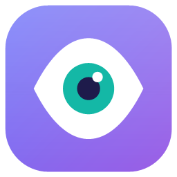
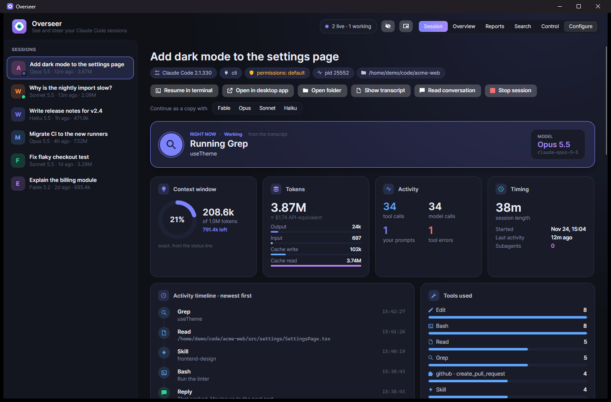
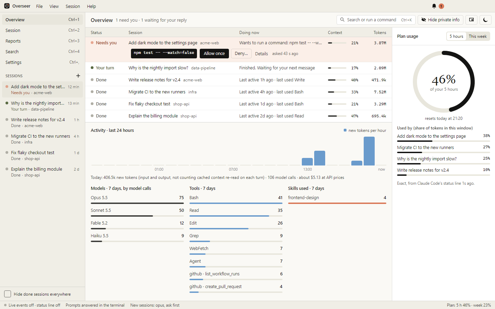
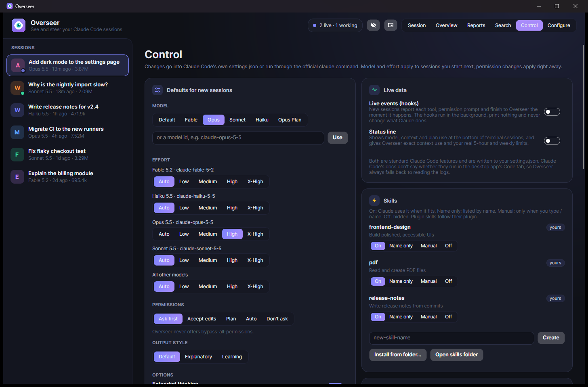
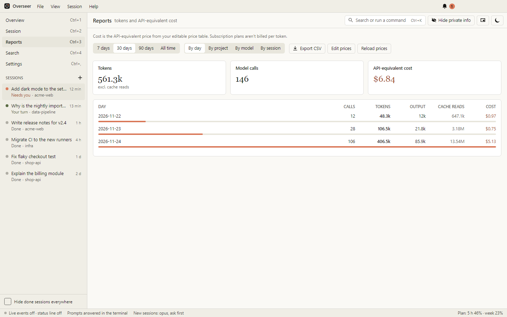
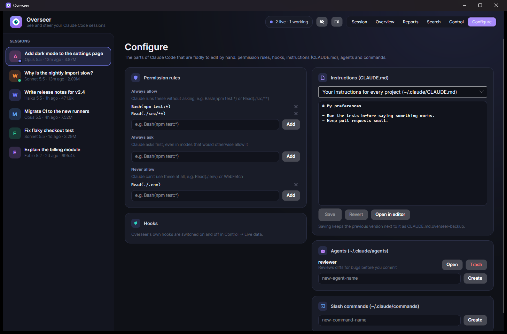

<p align="center">
  
</p>

<h1 align="center">Overseer</h1>

<p align="center">
  <b>See and steer your Claude Code sessions.</b><br>
  A desktop companion for Windows, macOS and Linux that shows what every Claude Code session is doing
  and lets you change models, skills, plugins, permissions and more without editing config files by hand.
</p>

<p align="center">
  <a href="https://github.com/Haidarsf/overseer/actions/workflows/ci.yml"></a>
  <a href="LICENSE"></a>
</p>

> Overseer is an independent, community project. It is not made, endorsed or supported by Anthropic.
> "Claude" and "Claude Code" are trademarks of Anthropic.



## Why

When you run several Claude Code sessions, it's hard to tell which one is working, which one is waiting for your permission, how full each context window is, and how close you are to your plan limits. Changing settings means editing `settings.json` by hand. Overseer puts all of that in one window.

## Features

**See**
- **Live sessions**: what each one is doing right now (running a tool, thinking, writing, waiting for you, waiting for permission)
- **Context window gauge**: exact from Claude Code's status line, or estimated from the transcript
- **Plan limits**: your real 5-hour and weekly usage, with reset times, from the status line
- **Activity timeline**, tools and MCP servers used, skills invoked, subagents, files changed, and the full conversation
- **Overview**: rolling 5-hour, daily and 7-day token use, tokens per hour, top models and tools
- **Reports** by day, project, model or session, with an API-equivalent cost estimate and CSV export
- **Search** across every conversation on your machine

**Steer**
- Default **model**, **effort** per model, **permission mode** and output style for new sessions
- **Presets** such as "Quick & cheap" or "Deep work", applied as defaults or used to start a session
- **Skills**: on, name only, manual or off (Claude Code's `skillOverrides`); create or install skills
- **Plugins**: enable, disable, uninstall, and install from the marketplace
- **MCP servers**: check status, add and remove
- **Permission rules**, **hooks**, **CLAUDE.md** instructions, **agents** and **slash commands**
- **Sessions**: start one in any folder with any model, resume one, open it in the Claude desktop app, continue it as a copy on another model, or stop it (gracefully first)

**Stay informed**
- **Tray icon** that changes colour: idle, working, or needs you
- **Desktop notifications** when Claude finishes, needs permission, keeps hitting errors, nears a context or plan limit
- **Mini mode**: a small always-on-top list of live sessions
- **Redact mode** hides your prompts, paths and emails for screenshots and streaming
- Dark and light themes, keyboard and screen-reader friendly controls

| Overview | Control |
| --- | --- |
|  |  |
| **Reports** | **Configure** |
|  |  |

## Install

Download the latest release from [Releases](https://github.com/Haidarsf/overseer/releases):

- **Windows 10 and 11**: `Overseer-Setup-<version>-x64.exe` installs Overseer for your user account (no administrator rights needed), adds it to the Start menu, and can start it when you sign in. Uninstalling removes the hooks and status line Overseer added to Claude Code and asks whether to delete its own data. A portable `.zip` is also available.
- **macOS and Linux**: unpack the `.tar.gz` and run `Overseer`.

Every build is self-contained, so nothing else is needed.

- **Windows**: builds aren't code-signed yet, so SmartScreen may warn you. Choose *More info → Run anyway*, or build from source.
- **macOS**: the app isn't notarized yet. After unpacking, run `xattr -dr com.apple.quarantine overseer-osx-*` or right-click → Open.
- **Linux**: needs a desktop with a system tray for the tray icon; `notify-send` for notifications.

Package-manager manifests for winget, Scoop and Homebrew are in [`packaging/`](packaging), ready to submit once there's a signed release.

## Try it without Claude Code

```sh
Overseer --demo
```

Demo mode makes up a handful of sessions in a temporary folder and points Overseer at it. Your real `~/.claude` is not read or changed. Plugin and MCP actions still run the real `claude` command, so don't click them in demo mode unless you mean it.

## Live data (optional, recommended)

Out of the box Overseer reads Claude Code's session logs. Two optional switches in **Control → Live data** make it exact and instant. Both are standard Claude Code features and are written to your `settings.json`:

| Switch | What it adds | How |
| --- | --- | --- |
| **Live events** | The exact tool being run, permission prompts the moment they appear, finish notifications | Registers `Overseer hook` as an async [hook](https://code.claude.com/docs/en/hooks) for session, prompt, tool, permission, notification and stop events. It appends the event to `~/.overseer/events/`, prints nothing and always exits 0, so it never changes what Claude does. |
| **Status line** | Exact context use and your real 5-hour and weekly plan limits | Sets Overseer as your [status line](https://code.claude.com/docs/en/statusline). It saves the JSON Claude Code sends and prints a one-line summary. Overseer won't replace an existing status line without asking. |

Turning a switch off removes exactly what Overseer added and nothing else. Claude Code's docs don't say whether hooks and the status line run in the Claude desktop app's Code tab, so Overseer always falls back to the logs.

## Privacy and safety

- **Local only.** Overseer makes no network requests of its own and has no telemetry. The only network activity comes from `claude plugin` and `claude mcp` commands you trigger.
- **Never reads your credentials** (`~/.claude/.credentials.json`).
- **Careful edits.** Every change goes through Claude Code's documented `settings.json` keys or the official `claude` CLI. The file is re-read before each change, other keys are kept, a backup (`settings.json.overseer-backup`) is written before the first change, and an invalid file is never overwritten.
- **Confirmations** before stopping a session, installing or uninstalling plugins, adding or removing MCP servers, and removing rules or hooks. Deleted agents and commands go to `~/.overseer/trash`.
- **No "bypass permissions" switch.** Overseer deliberately doesn't offer it.

More detail in [docs/PRIVACY.md](docs/PRIVACY.md).

## Build from source

You need the [.NET 8 SDK](https://dotnet.microsoft.com/download/dotnet/8.0).

```sh
git clone https://github.com/Haidarsf/overseer.git
cd overseer
dotnet test                                   # run the tests
dotnet run --project src/Overseer.App         # run the app
dotnet run --project src/Overseer.App -- --demo
```

Self-contained single-file build:

```sh
dotnet publish src/Overseer.App -c Release -r win-x64 --self-contained -p:PublishSingleFile=true -p:EnableCompressionInSingleFile=true -o out
```

Use `osx-arm64`, `osx-x64`, `linux-x64` or `linux-arm64` for other systems.

## How it works

| Piece | What it does |
| --- | --- |
| `src/Overseer.Core` | Everything that isn't UI: reads transcripts incrementally with a saved index, watches folders for changes, merges hook and status-line data, edits settings safely, runs the `claude` CLI, alerts, reports, search, redaction. No UI dependencies; fully unit-tested. |
| `src/Overseer.App` | The [Avalonia](https://avaloniaui.net) app: MVVM view models and XAML views, tray icon, notifications, mini mode, extension loader. |
| `tests/Overseer.Core.Tests` | xUnit tests with fixture transcripts. |

See [docs/ARCHITECTURE.md](docs/ARCHITECTURE.md) for the data sources and design, and [docs/EXTENSIONS.md](docs/EXTENSIONS.md) for the experimental extension API.

Overseer reads Claude Code's local files, some of which (session transcripts) are an internal format that can change between releases. Parsing is defensive and covered by tests; if something looks wrong after a Claude Code update, please [open an issue](https://github.com/Haidarsf/overseer/issues).

## Contributing

Contributions are welcome. Start with [CONTRIBUTING.md](CONTRIBUTING.md) and the [roadmap](ROADMAP.md).

## License

[MIT](LICENSE) © 2026 Haidar Saifaldeen
